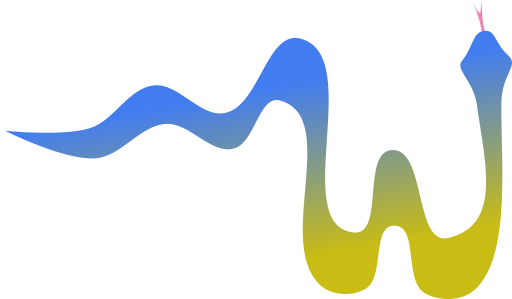

pySpinW
=======

.. image:: ../_static/img/pyspinw_logo.png
   :alt: pySpinW logo
   :align: center
   :class: only-light

pySpinW is the Python implementation of SpinW. It can calculate magnon
dispersion curves, optimize magnetic structures, visualize systems, and
predict the results of inelastic scattering experiments.

In compact form, the magnetic Hamiltonian has the form:

.. math::

   H = \sum_{i,j} S_i J_{ij} S_j
       + \sum_i S_i A_i S_i
       + B \sum_i g_i S_i

where :math:`S_i` are spin vector operators, :math:`J_{ij}` are 3x3 matrices
describing pair coupling between spins, :math:`A_{i}` are 3x3 anisotropy
matrices, :math:`B` is the external magnetic field, and :math:`g_i` is the
g-tensor.

The core calculations are a Rust-backed port of the SpinW algorithms, and the
Python interface is designed around constructing a model from objects rather
than filling in a fixed form. A minimal ferromagnetic chain looks like this:

.. code-block:: python

   from pyspinw import *

   unit_cell = UnitCell(1, 1, 1)
   site = LatticeSite(0, 0, 0, 0, 0, 1, name="X")
   structure = Structure([site], unit_cell=unit_cell)
   exchanges = [HeisenbergExchange(site, site, cell_offset=(1, 0, 0), j=-1)]
   hamiltonian = Hamiltonian(structure, exchanges)

The package makes the common user-facing classes available with
``from pyspinw import *``. The main entry points are:

* magnetic structures, unit cells, and sites
* exchange and anisotropy objects
* Hamiltonians and sample models
* supercells, propagation vectors, and helper constructors
* plotting, viewing, and example-generation utilities

For a more detailed API index, see the :doc:`API page <../api/pySpinW>`, and
for runnable examples, see :doc:`Examples <examples>`.

.. toctree::
   :maxdepth: 1
   :caption: User guide

   installation
   examples
   tutorials

.. toctree::
   :maxdepth: 1
   :caption: Reference

   ../api/pySpinW

